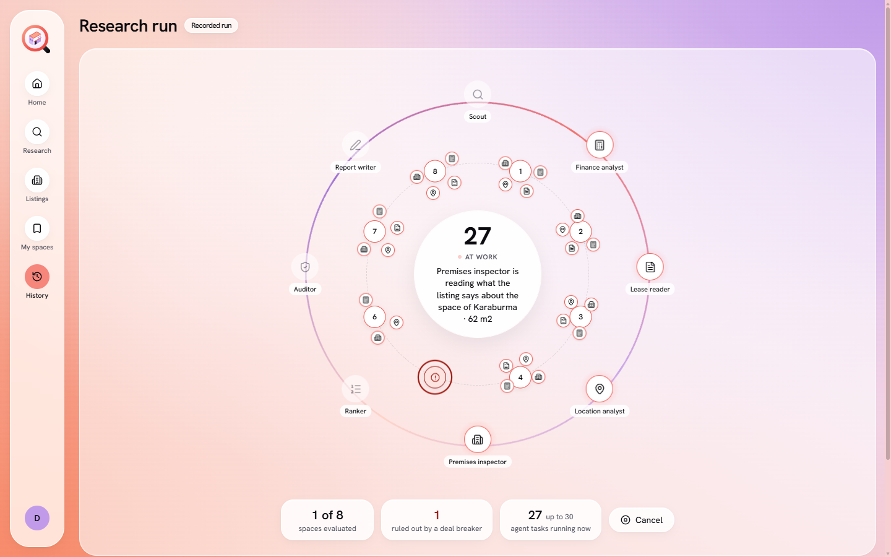
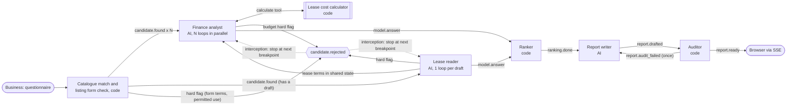

# SuiteSpot

**Is this lease a good financial decision for my business?** SuiteSpot answers that for a small business in about
ten seconds: Mozaik agents evaluate every candidate space at the same time, code does every calculation, a hard flag
in code stops the agents still working on a deal breaker, and every number on the screen points to its source.


> Built in 48 hours for the JigJoy Black Friday AI Hackathon (26-27 Nov 2026), track "AI agents in finance".
> **All listings, landlords and businesses are synthetic. Not financial or legal advice.**

- Demo video: **[link coming]** (2-3 min)
- Live deployment: **https://suitespot-production.up.railway.app** (sign up, then Research. The three demo scenarios
  and the whole deal loop run without any code; your own questionnaire runs the live model and needs the access code
  under Settings, so a public link cannot spend our key)
- Mozaik Cloud: [screenshot of a live run](#how-the-agents-run-concurrently) (the Cloud project is private)

## Contents
- [The problem](#the-problem)
- [Quick start (no key, no database)](#quick-start-no-key-no-database)
- [With an Anthropic key (live model)](#with-an-anthropic-key-live-model)
- [Optional: Supabase accounts and listings](#optional-supabase-accounts-and-listings)
- [How the agents run concurrently](#how-the-agents-run-concurrently)
- [Care with financial data](#care-with-financial-data)
- [Evidence: ten real-model evaluations](#evidence-ten-real-model-evaluations)
- [What is real, recorded and scripted](#what-is-real-recorded-and-scripted)
- [Architecture and code map](#architecture-and-code-map)
- [Tests](#tests)
- [Known limitations](#known-limitations)
- [Troubleshooting](#troubleshooting)
- [Credits](#credits)

## The problem
A small business owner (a cafe, a design office, a food shop) looks at five to eight commercial listings and one or
two lease drafts. To compare them honestly they must work out, for each space: the real monthly cost (rent plus
service charges), the money needed up front (deposit, fit-out, equipment), what leaving early would cost, what share
of expected revenue the space eats, and which lease clauses are deal breakers (no exit for ten years, a landlord who
may raise the rent at will, a permitted use that excludes their business). Done by hand that is an evening with a
spreadsheet per listing, and the clause that matters most is the easiest to miss.

SuiteSpot is a two-sided platform: landlords publish structured listings (rent, costs, area, term, early exit,
indexation, permitted use, optionally the lease draft), and a business either asks **Find spaces** (SuiteSpot picks
the listings that fit its questionnaire) or **Evaluate an outside listing** (it types in the terms of a space it found
elsewhere). Every candidate gets a score range, a verdict decided by code, and a list of what to check before signing.
When the business picks a space it can make an offer; once the landlord accepts, both sides see the same lease with
its rent due dates, and the tenant pays each month's rent (simulated, or Stripe in test mode).

Why a platform and not a scraper: we read the terms of use of the Serbian listing sites (4zida.rs, oglasi.rs,
svenekretnine.com) and none allows automated reading of their listings, so SuiteSpot reads only listings published
on SuiteSpot itself or terms the user types in.

## Quick start (no key, no database)
You need **Node.js 22 or newer** (check with `node -v`) and git. Nothing else: no API key, no database, no Docker.
Commands are for Windows PowerShell; they are the same in a macOS or Linux terminal.

```powershell
git clone https://github.com/g4jic/Black-Friday-Hackaton.git SuiteSpot
```
```powershell
cd SuiteSpot
```
```powershell
npm install
```
```powershell
npm run dev
```

We say `npm install` rather than `npm ci`. Both work on a fresh clone (we tested both), and every dependency is pinned
to an exact version in `package.json` with the lockfile committed, so both install the same versions. `npm install`
is simply the one that does not fail outright if your npm version reads the lockfile slightly differently, and it
does not delete an existing `node_modules` first. Use `npm ci` if you want a strict lockfile install.

`npm run dev` starts two processes: the API with the Mozaik runtime on port 3000 and the web app on port 5173.
Wait for the line `Local: http://localhost:5173/`, then open **http://localhost:5173**. No `.env` file is needed.

Then:
1. **Sign up** with any email and password. Without Supabase the account is kept on this computer only
   (`data/local-accounts.json`, password stored as a scrypt hash); the page says so.
2. Click **Research** in the top menu; the **Find spaces** tab is open.
3. Under "Demo scenario" pick one of the three: **Cafe in Novi Sad**, **Office in Beograd** or **Shop in Novi Sad**.
   The questionnaire on the left is locked to that scenario.
4. Click **Search and evaluate**.

What you see:
- **The run** (about 7 to 13 seconds): the agents travel on a path around the candidate spaces. Counters show the
  candidates evaluated, the ones ruled out by a deal breaker and **how many agent tasks run right now** (peak 30 in
  the office scenario). When code finds a deal breaker, that candidate turns red and moves to "Ruled out" with the
  reason, and any agent loop still working on it stops at its next breakpoint.
- **Results, List tab**: one ranked list, a verdict per space (Good, Check before signing, Not recommended), the
  score as a range ("74-94") when data is missing, the confidence and the main reason. Rejected spaces are in their
  own block with the hard flag that rejected them. Click a space for its page: costs with their sources, strengths
  and risks, lease terms or questions for the landlord, and what is unknown.
- **Report tab**: the audited report, one sentence per claim, each with the facts it cites and "Audited: N claims
  checked".
- **Timeline tab** ("How your research ran"): one lane per agent loop over time, calculator calls as dots, the loop
  that a hard flag cut, and the totals (duration, loops, peak at once, calculator calls, ruled out, loops stopped).
- Every result screen says **"Recorded run"**: without a key the agents replay a recorded real run of
  claude-haiku-4-5 (see [What is real, recorded and scripted](#what-is-real-recorded-and-scripted)).
- **How it works** (avatar menu): every weight, threshold and assumption, served from the code itself.



### Then rent a space, still with no key (offer, lease, rent payment)
1. Open any space (for example from the results, or under **Listings**) and use **Make an offer**: rent, start date,
   term, then **Send offer**.
2. A demo listing has no real landlord, so you answer as the **demo landlord (simulated)**: under **My spaces**, click **Accept as demo landlord**. Code
   creates the lease and its rent schedule (one due date per month).
3. Under **My spaces** the lease shows every month as upcoming, due, overdue or paid. Click **Pay rent (simulated)**: the
   checkout page is labelled **"Simulated payment, no real money"**; confirm it and the month turns **Paid
   (simulated)**, with the payment reference.
4. A landlord sees the same lease and the same paid month under **My listings** (sign in with a second account,
   publish a listing, and make the offer from the first one to see both sides).

With `STRIPE_SECRET_KEY=sk_test_...` and `STRIPE_PUBLISHABLE_KEY=pk_test_...` in `.env`, the same button opens a
**Stripe Checkout in test mode** instead (test card `4242 4242 4242 4242`); live keys are refused. Both go through one
payment port (`src/application/payments/payment-gateway.ts`) and are recorded the same way, only the reference
differs (`simulated:<id>` or the Stripe `cs_test_` session id). **Stripe test mode demonstrates the flow; Stripe does
not support businesses registered in Serbia, so a production version would use a local payment processor behind the
same port.** No real money moves in any mode.

Stop the servers with `Ctrl+C` in the terminal.

## With an Anthropic key (live model)
With a key the agents call the real model (`claude-haiku-4-5`, your own cost: about $0.05 to $0.10 per run) and you
can fill in your own questionnaire and evaluate an outside listing.

```powershell
Copy-Item .env.example .env
```
Open `.env`, set `ANTHROPIC_API_KEY=` to your key from console.anthropic.com, save, and run `npm run dev` again.
There is no mode switch: a server with a key runs live, a server without one runs the recorded demo. The key stays on
the server; the browser never receives it, and server events are scrubbed of it before they are streamed.

- `SUITESPOT_ACCESS_CODE` (optional): when set, live runs need this code (users enter it under Settings), so a public
  deployment cannot spend your key. The recorded demo never needs it.
- `MOZAIK_API_KEY` (optional): Mozaik Cloud tracing. Easier: run the pairing once, see below.
- `STRIPE_SECRET_KEY` and `STRIPE_PUBLISHABLE_KEY` (optional, test keys only): rent payments through Stripe Checkout
  in test mode instead of the simulated checkout.

## Optional: Supabase accounts and listings
Without Supabase, listings come from a local store (the 100 seeded synthetic listings, plus anything you publish
locally into `data/local-listings.json`), accounts are kept on this computer (`data/local-accounts.json`) and offers,
leases and rent payments in `data/local-deals.json`. With a Supabase project:
1. Apply the migrations in `supabase/migrations/` (tables `listings`, `listing_contacts`, `saved_listings`,
   `listing_views`, and for deals `offers`, `tenancies`, `rent_payments`, all with row level security: each party
   reads only its own offers, leases and payments, and only the server writes them, after the domain rules pass).
   `supabase/checks/rls-checks.sql` holds the RLS checks we ran ("all RLS checks passed").
2. Set `SUPABASE_URL`, `SUPABASE_ANON_KEY` and `SUPABASE_SERVICE_ROLE_KEY` in `.env`. The service role key is used by
   the server and the seed script only, never sent to the browser.
3. `npm run seed:supabase` creates the 100 demo landlords and listings (idempotent).
4. For a public deployment: in Supabase Auth set the Site URL and the redirect URL to the deployed address, and turn
   off "Confirm email" (the default Supabase mail sender is rate limited).

Then sign up, publish a listing, save spaces under My spaces and see view counts under My listings. Contacts live in
their own table that anonymous users cannot read; the server reveals one only on "Show contact", and demo phone
numbers are partly masked with no tel: links.

## How the agents run concurrently
Built on **`@mozaik-ai/core` 6.0.0**. Every research run gets its own Mozaik runtime: one shared typed
`RuntimeState`, and participants that join it. **There is no orchestrator.** Nobody calls or awaits an agent: every
event goes to every participant, and each one decides through its situation handlers whether to react. `runLoop` is
fire-and-forget, so each candidate gets its own loop with its own context, and many loops think and call tools at the
same time.

| Participant | AI or code | Wakes on | Does | Publishes |
|---|---|---|---|---|
| Catalogue match and listing form check | code | the user starts Find spaces or an evaluation | Picks the listings that fit the questionnaire (city, area, business type, budget + 10%) and adds each as a candidate, every value sourced to a listing form field; checks permitted use on every candidate, and applies the lease rules to the form terms when there is no lease draft | `catalogue.matched`, `candidate.found` (one per candidate), `candidate.rejected` on a deal breaker |
| **Finance analyst** | **AI** (one loop per candidate) | `candidate.found` | Calls the `calculate` tool (code) for monthly cost, initial costs, cost per m2; waits in state for the lease terms; then cost over the term, exit cost, share of revenue, break-even, payback; explains in at most 120 words using only returned numbers | `finance.explained`, `candidate.rejected` (budget hard flag, decided by code) |
| **Lease reader** | **AI** (one loop per lease draft) | `candidate.found` with a draft | Reads the draft into clauses, each with an exact quote; code checks every quote against the draft and decides hard flags and concerns | `lease.read`, `candidate.rejected` |
| **Location analyst** | **AI** (one loop per candidate) | `candidate.found` | Calls `area_data` (code counts places mapped in OpenStreetMap within 300 m: same business, transport, schools, offices, parking, and the land use around the address); explains them for this business using only returned numbers; code decides the location score and whether noisy work next to housing is a point to check | `location.explained` |
| **Premises inspector** | **AI** (one loop per candidate) | `candidate.found` | Reads the listing and the lease draft for floor, storefront, parking, heating, kitchen ventilation, water and drain, renovation and step-free access, each with an exact quote; code checks the quotes and decides what suits the business | `premises.read` |
| **Scout** | **AI** | pasted listing text (Evaluate an outside listing) | Reads the pasted text into fields with quotes, in its own loop next to the others; code compares them with the typed fields | `listing.compared` |
| Candidate cancellation | code (interception) | before every step of every loop | When the candidate of that loop is rejected, stops the loop at its breakpoint: no further model call, a tool call in flight is answered "stopped" | `loop.cancelled` |
| Ranker | code | the room is quiet (every candidate read, no loop running) | Scores each candidate as a worst-case range, ranks by the low end, sets confidence and the verdict | `candidate.scored`, `ranking.done` |
| **Report writer** | **AI** | `ranking.done`, `report.audit_failed` | Writes the report only from numbered facts that code wrote from state, citing them per sentence | `report.drafted` |
| Auditor | code | `report.drafted` | Checks every sentence against the facts it cites (numbers, candidate ids, no rejected candidate recommended, top 3 only); sends problems back once, then removes failing sentences | `audit.done`, `report.audit_failed`, `report.ready` |
| Wire tap | code (observer) | every event | Streams a whitelisted projection of the bus to the browser over Server-Sent Events and computes the metrics | nothing on the bus |

Where the concurrency honestly comes from:
- **Volume**: with 8 candidates, 8 Finance analyst, 8 Location analyst and 8 Premises inspector loops plus one Lease
  reader loop per draft run at the same time.
- **Independent reviews of the same candidate**: the Finance analyst, the Lease reader, the Location analyst and the
  Premises inspector start on the same `candidate.found` and read different inputs (the numbers, the lease draft,
  the area data, the description of the space).
- **Reactions mid-run**: the Lease reader's lease terms land in shared state while the Finance analyst's loop is
  already running; Finance waits for them in state, not by calling the Lease reader. A hard flag from any participant
  rejects the candidate in state, and the interception stops every other loop on it at its next step.
- **Checks between agents**: code checks every quote the Lease reader and the Scout return against the source text;
  the Auditor checks the Report writer against the facts.



**Proof, not a claim.** The Timeline tab draws every loop as a lane from the runtime's own events, with the peak
number of loops in parallel. The three recorded scenarios, replayed without a key (27 Nov 2026, evening); every report passed the audit on the first draft (11, 10 and 10 claims checked, 0 corrected, 0 removed):

| Scenario | Duration | Agent loops | Peak in parallel | Rejected by a hard flag | Loops stopped |
|---|---|---|---|---|---|
| Cafe in Novi Sad | 12.6 s | 31 | 27 | 2 | 6 |
| Office in Beograd | 10.0 s | 32 | 30 | 2 | 5 |
| Shop in Novi Sad | 7.3 s | 29 | 28 | 4 | 10 |

The cut that shows the mechanism best: in **Office in Beograd** the Finance analyst works on "Voždovac, 51 m2" for
about 4.6 s, then the Lease reader finds that the landlord may raise the rent without a limit, and the Finance loop
stops before its next tool call. In **Shop in Novi Sad** two candidates are cut by the Lease reader at the same
moment (about 3.7 s). `npx tsx scripts/cut-report.ts` prints every cut.


Each run also appears in Mozaik Cloud, one session per agent loop (the screenshot below is from before the Location
analyst and the Premises inspector joined, so it shows three AI roles). The core sends every loop event when it finds a
key (`MOZAIK_API_KEY` in `.env`, or a machine paired once with `npx @mozaik-ai/cloud-sdk pair`); without one it
prints "telemetry disabled" and runs normally. One live run of the cafe scenario (27 Nov 2026, claude-haiku-4-5,
22.7 s, about $0.06) in our Cloud project:


- **Finance analyst, 9 loops**: one per candidate (8), plus one retry after code rejected an explanation. Two of
  them were cut by a hard flag before their first model call. 21 inferences, 14 calculator calls.
- **Lease reader, 4 loops**: one per lease draft (3), plus one retry after code rejected an extraction.
- **Report writer, 1 loop**: the audit passed the first draft (14 claims checked, 0 corrected, 0 removed).
- Ranker, Auditor and the catalogue match are plain code, so they have no loops in Cloud.

Mechanisms, with the file that implements each:

| Mechanism | Where |
|---|---|
| One runtime per run, shared `RuntimeState`, one fresh context per loop | `src/application/runtime.ts`, `src/application/state.ts` |
| Situation handlers per agent (no keywords, typed event checks) | `src/application/agents/*.ts` |
| Hard flag stops other loops at their breakpoint (Mozaik `InterceptionHandler`) | `src/application/cancellation/candidate-cancellation.ts` |
| User "Cancel" stops the whole run the same way | `src/application/cancellation/run-cancellation.ts` |
| Finance waits for the lease terms in state | `waitForLease` in `src/application/state.ts` |
| At most one tool call per answer (`disable_parallel_tool_use`) | `src/adapters/inference/live-runner.ts` |
| Retries with backoff, a semaphore of 8 model calls, a provider error never crashes the room | `src/application/resilience/` |
| Recorded runs replayed with the recorded latencies | `src/adapters/inference/recording-runner.ts` |
| Event stream and metrics for the browser | `src/application/research/research-session.ts` |

## Care with financial data
- **Every number has a source.** A value is a `Sourced<T>` with a `SourceRef`: a listing form field, a lease quote, a
  questionnaire answer, or a calculation that lists its inputs. `validateSource` rejects a malformed source and the
  state rejects a finding without one (`src/domain/source.ts`, `src/application/state.ts`). The UI shows the source
  next to the number in plain words.
- **Models read; code calculates and decides.** The Finance analyst never computes: it calls the `calculate` tool
  (`src/domain/lease-cost.ts`). A deposit stated as "3 months of rent" is converted by code. Every number in an
  explanation must be one the tool returned, or the explanation is rejected (`src/domain/number-check.ts`).
- **Quotes are checked.** The Lease reader and the Scout must return the exact text they read a value from; code
  finds the quote in the source and checks the value against it. A field that fails on the last attempt becomes
  "could not confirm" with the reason, never a guess (`src/domain/quoted-extraction.ts`).
- **Hard flags are code, and they cut running loops.** Over budget (more than 10% above), a permitted use that
  excludes the business, no early exit with a term over 36 months, and a landlord who may raise the rent without a
  limit reject the candidate with a source (`src/domain/hard-flags.ts`, `src/domain/lease.ts`). The first hard flag
  wins, and every loop still working on that candidate stops at its next breakpoint, before the next model call.
- **Ranked by the worst case.** Missing data never inflates a score: an unknown part counts as 0 for the low end and
  full for the high end, the score is shown as a range ("74-94"), and the rank uses the low end. A space with no
  stated rent is never first. The rank goes by verdict first (Good, then Check before signing, then the rest) and by
  the low end inside each verdict, so the best option never has a weaker verdict than another candidate. Confidence says why ("no lease draft: up to 20 points unknown")
  (`src/domain/ranking.ts`).
- **The verdict is code.** Good needs 70 or more in the worst case, high confidence and nothing to check; a space
  outside the required area range is never Good (`src/domain/verdict.ts`). The weights and rules are on the
  How it works page, served from the code itself so the page cannot drift.
- **More answers on each space page, all code figures with sources:**
  - *Rent share of revenue*: the monthly cost as a share of the expected revenue from the questionnaire; above 15%
    it is a point to check (a SuiteSpot assumption, labelled as one, never a rejection) (`rentShareOf` in
    `src/domain/ranking.ts`).
  - *Noise vs land use*: for noisy work (a cafe, a workshop) code reads the OpenStreetMap land use around the address;
    dense housing nearby is a point to check about neighbours (`noiseCheck` in `src/domain/location.ts`, data
    `fixtures/osm/seed-areas.json`, © OpenStreetMap contributors, ODbL).
  - *A bad year, a good year*: what leaving after 12 months would cost (from the lease's own exit terms), and when
    the money put in comes back in a normal year (from the Finance analyst's calculator figures only).
  - *Lease or buy*: rent over the planned stay against buying a similar space with a bank loan. Prices per m2 from
    RGZ (first half of 2026), the loan rate from NBS (August 2026), the transfer and property tax from the Law on
    property taxes; down payment 30%, 10 years, fees 2%, maintenance 1% and a 3% return on cash are SuiteSpot
    assumptions, labelled as such (`src/domain/lease-or-buy.ts`).
- **The report is audited by code.** The Report writer gets numbered facts written by code and must cite them in
  every sentence. The Auditor checks each number, candidate id and recommendation against the cited facts and the
  ranking; one rewrite, then failing sentences are removed and marked (`src/domain/report.ts`,
  `src/application/agents/auditor.ts`).
- **Not financial or legal advice** is shown on every result screen, in the report and here. SuiteSpot never says
  whether to sign and never gives a legal verdict on permitted use; it lists what to check before signing.

## Evidence: ten real-model evaluations
Before recording the demo we ran ten outside listings through the live model (`scripts/eval-scenarios.ts`), each
built to test one rule. The first pass found two wrong verdicts (a space with no lease draft rated Good with high
confidence; a 140 m2 space rated Good for a business that needs 40 to 90 m2). Both were fixed in code, with tests.
Second pass:

| # | Scenario | Expected | Score (confidence), verdict | Hard flags | Concerns |
|---|---|---|---|---|---|
| 1 | Cafe Novi Sad, good lease | good, top score | 96 (high), Good | - | - |
| 2 | Cafe Novi Sad, over budget | budget hard flag | rejected, Not recommended | monthly_cost_over_budget | - |
| 3 | Cafe Novi Sad, office use only | permitted use hard flag | rejected, Not recommended | permitted_use_excludes_business | - |
| 4 | Cafe Novi Sad, locked in, landlord raises rent | no exit, unlimited increase | rejected, Not recommended | locked_in_without_exit, unlimited_rent_increase | - |
| 5 | Cafe Novi Sad, no lease draft | lower confidence | 92 (medium), Check before signing | - | - |
| 6 | Office Beograd, good | good | 85 (high), Good | - | - |
| 7 | Office Beograd, harsh lease | guarantee, penalty, structural, 8% a year | 66 (high), Check before signing | - | personal guarantee, tenant pays structural repairs, long notice, high indexation, early exit penalty |
| 8 | Shop Novi Sad, good | good | 84 (high), Good | - | - |
| 9 | Shop Novi Sad, too big | area outside the range | 73 (high), Check before signing | - | - |
| 10 | Workshop Beograd, vague lease | missing data, low confidence | 64-84 (medium), Check before signing | - | - |

All ten verdicts are right. Details, including the first report sentence of each run, are in `PROGRESS.md` ("P4
quality check").

## What is real, recorded and scripted
| Part | Status |
|---|---|
| Mozaik runtime, concurrency, interception, shared state | Real, in every mode |
| Domain rules, calculations, hard flags, ranking, verdict, audit | Real code, in every mode |
| Model answers with a key | Real: claude-haiku-4-5, live |
| Model answers without a key, Find spaces | **Recorded**: three real claude-haiku-4-5 runs (`fixtures/recordings/*.json`, recorded 27 Nov 2026: 23, 27 and 21 model calls) replayed with their latencies; code still checks every value. A request that is not in the recording fails as a provider error, it is never invented. Labelled "Recorded run" |
| Model answers without a key, "Evaluate for my business" on a demo listing | **Scripted**: answers built from the seed's own clause sentences, still checked by code. Labelled "Scripted demo answers, no AI model" |
| Listings, landlords, contacts, businesses | **Synthetic**: 100 generated listings (50 Novi Sad, 50 Beograd) from a frozen seed, labelled "Demo listing". Prices per m2 are a synthetic assumption roughly aligned with public 2025-2026 ranges (Kurir Biznis, Biznis.rs): medians Novi Sad 10, Beograd 16.2 EUR/m2 |
| Accounts, saved spaces, view counts | Real: Supabase Auth with Supabase, local accounts on this computer without it |
| Area data (OpenStreetMap) | Real public data: counted once for the seeded addresses and stored in `fixtures/osm/` (© OpenStreetMap contributors, ODbL); an outside listing is looked up live (at most 1 request per second) |
| Offers, leases, rent schedule | Real code and storage (Supabase or local); on a demo listing the landlord's answer is given by the tenant as the "demo landlord (simulated)" |
| Rent payments | **Simulated** without Stripe keys ("Simulated payment, no real money"); **Stripe test mode** with test keys. Never real money |
| Signing a lease, contacting landlords | Not built |

## Architecture and code map
Domain-driven layers; the domain never imports from adapters (checked by `tests/architecture.test.ts`).

```
src/domain/        entities, value objects, rules, typed domain errors (no I/O, no model)
src/application/   agents (participants), situation handlers, interception, shared state, the research session
src/adapters/      server (Fastify + SSE), inference runners (live, recorded, scripted), storage, Supabase auth, seed
web/               React + Vite + Tailwind front end, styled by DESIGN.md
fixtures/          locked demo questionnaires and the recorded runs
supabase/          migrations and RLS checks
```

Production build: `npm run build`, then `npm start` (one process serves the web app and the API on `PORT`).

## Tests
```powershell
npm test
```
```powershell
npm run typecheck
```
227 tests in 31 files, no key and no network needed (`tests/setup.ts` turns Mozaik Cloud off and blocks any request
to another host): every domain rule and invariant (with the violation it rejects), the schema
rules for every structured output, cancellation mid-run, a failing agent that does not stop the others, the server
and its cost guards, the three recorded scenarios replayed end to end to an audited report, the frozen seed, and
the full deal loop over HTTP (offer, accept, lease, simulated payment, status on both sides; the Stripe test gateway
against a fake fetch).

## Known limitations
- Without a key, Find spaces runs only the three recorded scenarios with their locked questionnaires; your own
  questionnaire and "Evaluate an outside listing" need a key.
- A recording matches the agent instructions it was made with; after changing an instruction it must be re-recorded
  (`npm run record:demo`), and `tests/recorded-demo.test.ts` fails until it is.
- Code removes phone numbers and emails from pasted listing text but cannot reliably detect a person's name; the
  Scout has no field for names. Do not paste text with private details.
- Not built: an inspection of the premises on site, signing a lease, messages between users, a real payment
  processor (Stripe does not support businesses registered in Serbia; production would use a local processor
  behind the same payment port). Only EUR and the two seeded cities are covered by the demo data.
- OpenStreetMap counts what is mapped, not foot traffic or revenue; the Location analyst says so and never estimates
  them.
- Lease or buy is a rough comparison with labelled assumptions (no price change, no VAT on a new building), not a
  valuation.
- `RequireLandlord` and `auth.landlord` keep old names in code (the UI texts are neutral).

## Troubleshooting
| Problem | Fix |
|---|---|
| `npm run dev` says port 3000 is in use, or the page says "The SuiteSpot server is not answering" | Another program uses port 3000. Close it and run `npm run dev` again. |
| Vite opens on 5174 instead of 5173 | Port 5173 was taken; open the address Vite prints. |
| `node -v` shows 20 or lower | Install Node.js 22 LTS or newer from nodejs.org. |
| Find spaces shows only demo scenarios | Expected without a key. Add `ANTHROPIC_API_KEY` to `.env` and restart for live runs. |
| A live run answers 401 | The server has `SUITESPOT_ACCESS_CODE` set; enter the code under Settings. |
| A live run answers 429 | One live run at a time per server; wait for it to finish. |
| `npm install` warns that install scripts were skipped (npm 11) | Nothing to do: tested on a fresh clone with npm 11.20 and Node 26 (install, tests, build and the keyless demo all work). If `npm run dev` ever fails with an esbuild error, run `npm rebuild esbuild`. |
| Signing up asks for an email confirmation (Supabase) | Turn off "Confirm email" in Supabase Auth, or use the local accounts (leave SUPABASE_* empty). |

## Credits
- Team **Scope**: Aleksa Ćupina and Andrej Gajić.
- Built on [`@mozaik-ai/core`](https://www.npmjs.com/package/@mozaik-ai/core) 6.0.0 by JigJoy; traces in Mozaik
  Cloud.
- Model: Anthropic claude-haiku-4-5.
- Fastify, React, Vite, Tailwind CSS, Supabase, Vitest, playwright-core (screenshots). Font: Hanken Grotesk (SIL Open
  Font License 1.1). Icons: lucide (ISC).
- All data is synthetic. Not financial or legal advice.
