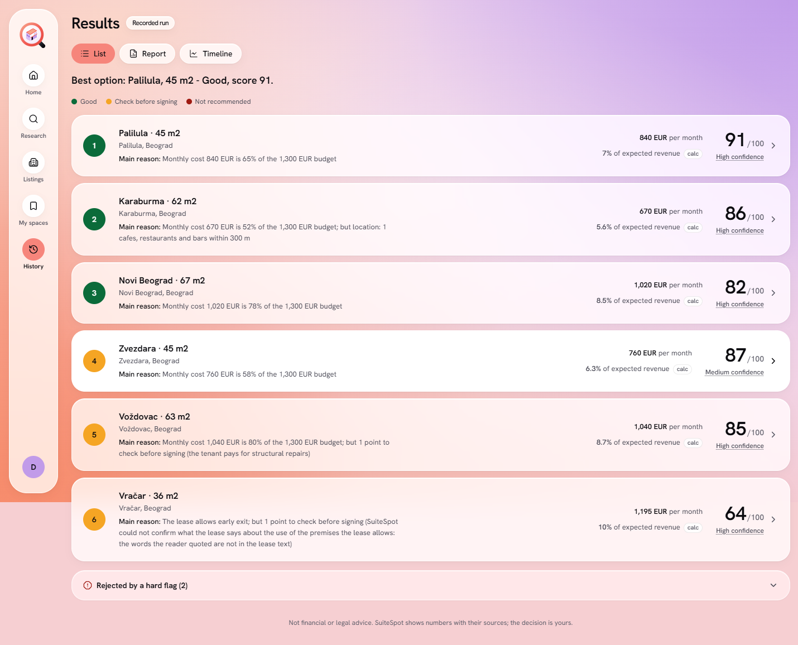
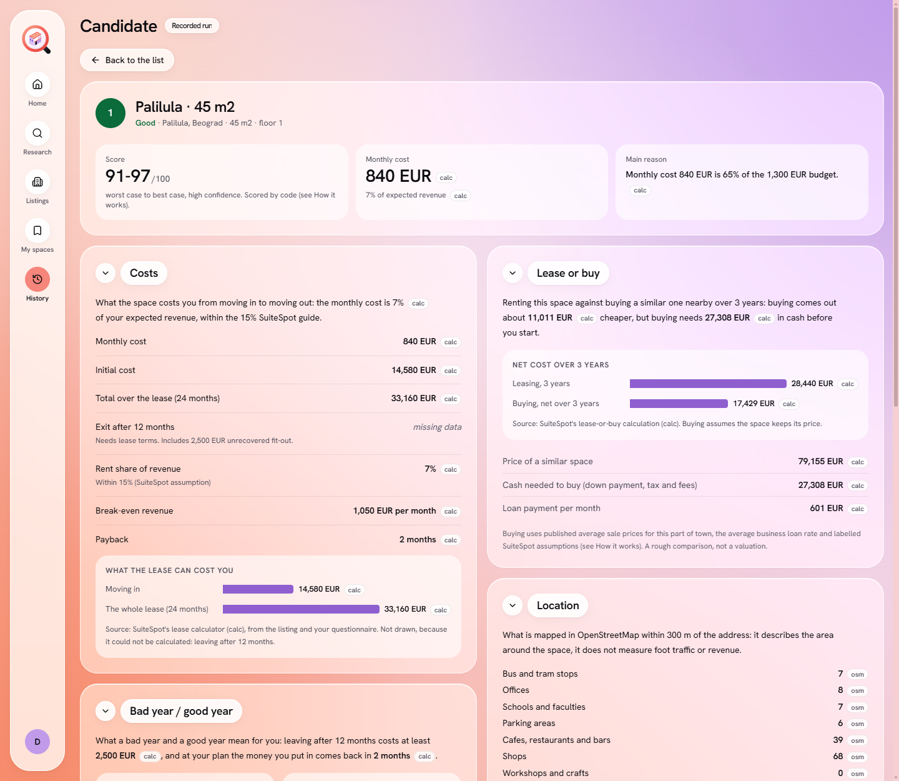
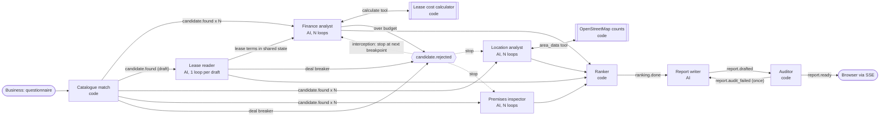
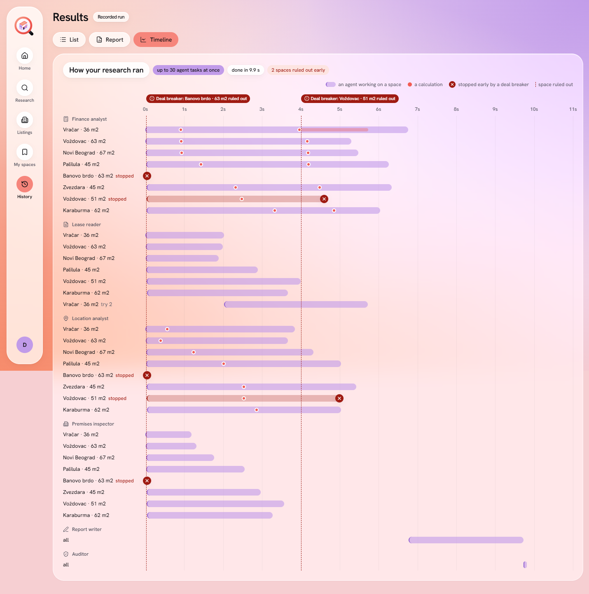
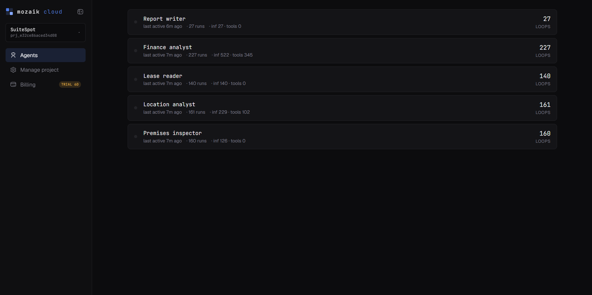

# SuiteSpot

**SuiteSpot finds a small business the best financial deal on a commercial space.** The business says what it
needs. Mozaik agents then evaluate every matching space at the same time, from every financial angle:

- the real monthly cost and the money needed up front;
- the cost of leaving early;
- the rent's share of revenue;
- the lease risks;
- leasing against buying.

They rank the spaces so the business sees which one is its best financial case, and why. Code does every
calculation, stops the agents the moment it finds a deal breaker, and checks every number against its source. The
answer takes about ten seconds instead of an evening with a spreadsheet.



- **Live:** https://suitespot-production.up.railway.app (sign up with any email; runs the real model)
- **Local:** no key, no database, four commands ([Quick start](#quick-start))
- Team **Scope** (Aleksa Ćupina, Andrej Gajić). Built during the JigJoy Black Friday AI Hackathon, 26-27 Nov 2026,
  track "AI agents in finance".
- **All listings, space owners and businesses are synthetic. Not financial or legal advice.**

## Contents
[The problem](#the-problem) · [Quick start](#quick-start) · [What you see](#what-you-see) ·
[How the agents run concurrently](#how-the-agents-run-concurrently) · [Care with financial data](#care-with-financial-data) ·
[Evidence](#evidence-ten-live-evaluations) · [Real, recorded, scripted](#real-recorded-scripted) ·
[Optional setup](#optional-setup) · [Architecture](#architecture) · [Tests](#tests) ·
[Limitations](#limitations) · [Troubleshooting](#troubleshooting) · [License and credits](#license-and-credits)

## The problem
A cafe, a design office or a shop compares five to eight listings and one or two lease drafts. For each it must work
out:

- the real monthly cost and the money needed up front;
- what leaving early costs;
- what share of revenue the rent eats;
- which clause is a deal breaker (no exit for ten years, an owner who may raise the rent at will, a permitted use
  that excludes the business).

The clause that matters most is the easiest to miss.

SuiteSpot is a two-sided platform:

- **Space owners** publish structured listings: terms, an optional lease draft and up to six photos.
- **A business** fills in a questionnaire and either:
  - asks **Find spaces**: SuiteSpot picks the listings that fit, or
  - **evaluates one listing**: from SuiteSpot, or a space found elsewhere whose terms it types in.

**Every agent works toward one goal: the best financial case for this business.** Every candidate gets a score
range, a verdict decided by code and a list of what to check before signing. The ranking puts the best financial
case first. The
business can then make an offer. Once it is accepted, both sides see the same lease and its rent schedule, and the
tenant pays rent: simulated locally, Stripe test mode online.

We read no other listing site: the Serbian ones (4zida.rs, oglasi.rs, svenekretnine.com) forbid automated reading in
their terms.

## Quick start
You need **Node.js 22 or newer** (`node -v`) and git. Nothing else: no API key, no database, no Docker.

```powershell
git clone https://github.com/g4jic/Black-Friday-Hackaton.git SuiteSpot
```
```powershell
cd SuiteSpot
```
```powershell
npm install
```
```powershell
npm run dev
```

Open **http://localhost:5173** once Vite prints `Local: http://localhost:5173/`. The API with the Mozaik runtime runs
on port 3000.

1. **Sign up** with any email and password. The account is kept on this computer.
2. **Onboarding:** choose **Find a space**, then **Skip for now**.
3. **Research:** pick **Office in Beograd** (or the cafe or the shop) and click **Search and evaluate**.
4. Watch the run (about 10 s). The results open by themselves.
5. **Rent a space:**
   1. Open a space and choose **Make an offer**.
   2. Under **My spaces**, click **Accept**. A seeded listing has no real owner, so you answer your own offer.
   3. Click **Pay rent**. A simulated checkout opens: no card, no money.

Without a key the three example businesses replay **recorded real runs** of claude-haiku-4-5. Every other run (your
own questionnaire, any listing, an outside listing) uses **scripted agents**; see
[Real, recorded, scripted](#real-recorded-scripted). Stop the servers with `Ctrl+C`.

## What you see


- **The run.** The agents start on the outer circle.
  - An agent with running loops moves into the white field.
  - **Every running loop is a dot circling its agent**, and the centre counts them (peak 30 in the office scenario).
  - A lilac link joins two agents while both work on the same space.
  - **Deal breaker:** the agent that found it turns red, the loops it stopped fly off and the space moves to
    "Ruled out" with its reason.
  - **Lease terms** (Lease reader to Finance analyst) and **Sent back** (Auditor to Report writer) make the two agents
    meet.

  Every dot, link and pulse is a real bus event (`web/src/run/orbit-model.ts`, checked against the recordings in
  `tests/orbit-model.test.ts`). Only the paths the agents take are free.
- **Results:** a ranked list. The rank circle's colour is the verdict (Good, Check before signing, Not recommended),
  shown with the score, monthly cost and main reason. Rejected spaces are listed apart, each with its deal breaker.
- **A space's page:** a summary, then cards (Costs, Bad year / good year, Lease or buy, Lease terms, Location, The
  space, Risks, What is unknown). Every number shows its source.
- **Report:** the audited report. Each sentence cites the facts it uses, with "Audited: N claims checked".
- **Timeline:** one lane per agent loop, with calculator calls, the loops a deal breaker cut and the peak in parallel.
- **How it works** (avatar menu): every weight, threshold and assumption, served from the code itself.



## How the agents run concurrently
Built on **`@mozaik-ai/core` 6.0.0**. Each agent judges one side of the financial case: cost, lease, location or
premises. The Ranker weighs them into one ranking, worst case first.

- Every research run is one Mozaik runtime with one shared, typed `RuntimeState`.
- **There is no orchestrator.** Every event reaches every participant, and each one decides through its own situation
  handlers whether to react.
- `runLoop` is fire-and-forget, so every candidate gets its own loops with their own context, all running at once.

| Participant | AI or code | Wakes on | Does |
|---|---|---|---|
| Catalogue match | code | the user starts a search | Picks the listings that fit (city, area, use, budget + 10%), checks permitted use and the form terms; publishes `candidate.found` per space |
| **Finance analyst** | **AI**, one loop per space | `candidate.found` | Calls the `calculate` tool (code) for every figure, waits in state for the lease terms, explains using only returned numbers |
| **Lease reader** | **AI**, one loop per lease draft | `candidate.found` with a draft | Reads clauses with exact quotes; code checks each quote and decides deal breakers |
| **Location analyst** | **AI**, one loop per space | `candidate.found` | Explains OpenStreetMap counts within 300 m (code counts them); code decides the score |
| **Premises inspector** | **AI**, one loop per space | `candidate.found` | Reads floor, storefront, ventilation, access and more, each with a quote; code decides the fit |
| **Scout** | **AI** | pasted text of an outside listing | Reads it into fields with quotes; code compares them with the typed fields |
| Cancellation | code (interception) | before every step of every loop | Stops every loop on a rejected space at its next breakpoint |
| Ranker | code | the room is quiet | Worst-case score range, rank, confidence, verdict |
| **Report writer** | **AI** | `ranking.done`, `report.audit_failed` | Writes only from numbered facts that code built from state |
| Auditor | code | `report.drafted` | Checks every sentence against its facts; sends it back once, then removes what fails |

Where the concurrency comes from:
- **Volume:** with 8 candidates, 8 Finance, 8 Location and 8 Premises loops run at once, plus one Lease reader loop per
  draft.
- **Independent reviews:** four roles start on the same `candidate.found` and read different inputs.
- **Reactions mid-run:** the Lease reader's terms land in state while the Finance loop is running, and Finance waits
  for them in state (never a call). A deal breaker from any participant rejects the space in state, and the
  interception stops every other loop on it before its next model call.
- **Checks between agents:** code checks every quote against the source text, and the Auditor checks the Report writer.



**Proof.** The three recorded scenarios, replayed without a key. Every report passed the audit on the first draft.

| Scenario | Duration | Agent loops | Peak in parallel | Rejected by a deal breaker | Loops stopped |
|---|---|---|---|---|---|
| Cafe in Novi Sad | 12.6 s | 31 | 27 | 2 | 6 |
| Office in Beograd | 10.0 s | 32 | 30 | 2 | 5 |
| Shop in Novi Sad | 7.3 s | 29 | 28 | 4 | 10 |

Example: in **Office in Beograd** the Finance analyst works on "Voždovac, 51 m2" for 4.6 s. Then the Lease reader finds
that the owner may raise the rent without a limit, and the Finance loop stops before its next tool call.
`npx tsx scripts/cut-report.ts` prints every cut.



**Mozaik Cloud** records one session per agent loop. A live run of **Cafe in Novi Sad** (claude-haiku-4-5, 15.8 s,
$0.098) had 31 loops, a peak of 27 in parallel and 6 loops cut. The screenshot below sums every run of 27 Nov 2026
(the Cloud project is private). Ranker, Auditor and the catalogue match are plain code, so they have no loops there.



| Mechanism | Where |
|---|---|
| One runtime per run, shared `RuntimeState`, one fresh context per loop | `src/application/runtime.ts`, `src/application/state.ts` |
| Situation handlers per agent (typed event checks, no keywords) | `src/application/agents/*.ts` |
| A deal breaker stops other loops at their breakpoint (`InterceptionHandler`) | `src/application/cancellation/candidate-cancellation.ts` |
| The user's Cancel stops the whole run the same way | `src/application/cancellation/run-cancellation.ts` |
| Finance waits for the lease terms in state | `waitForLease` in `src/application/state.ts` |
| At most one tool call per answer (`disable_parallel_tool_use`) | `src/adapters/inference/live-runner.ts` |
| Retries with backoff and a semaphore of 8 model calls; a provider error never crashes the room | `src/application/resilience/` |
| Recorded runs replayed with their recorded latencies | `src/adapters/inference/recording-runner.ts` |

## Care with financial data
- **Every number has a source.**
  - A value is `Sourced<T>`: a listing form field, a lease quote, a questionnaire answer, or a calculation that lists
    its inputs.
  - State rejects a finding without one (`src/domain/source.ts`), and the UI shows the source next to the number.
- **Models read; code calculates and decides.**
  - The Finance analyst calls the `calculate` tool (`src/domain/lease-cost.ts`) for every figure.
  - An explanation that uses a number the tool did not return is rejected (`src/domain/number-check.ts`).
- **Quotes are checked.**
  - The Lease reader, the Scout and the Premises inspector must return the exact text behind each value.
  - Code finds that text in the source. A value that fails becomes "could not confirm", never a guess
    (`src/domain/quoted-extraction.ts`).
- **Deal breakers are code.** Each rejects the space with its source (`src/domain/hard-flags.ts`):
  - over budget by more than 10%;
  - a permitted use that excludes the business;
  - no early exit with a term over 36 months;
  - an owner who may raise the rent without a limit.
- **Ranked by the worst case.**
  - Unknown data counts as 0 for the low end, and the score is shown as a range ("74-94").
  - The rank uses the low end (`src/domain/ranking.ts`). **Good** needs 70 or more in the worst case, high confidence
    and nothing to check (`src/domain/verdict.ts`).
- **Assumptions are labelled.**
  - Lease or buy uses RGZ prices (first half of 2026), the NBS loan rate (August 2026) and the property tax law;
    SuiteSpot's own assumptions are marked as such (`src/domain/lease-or-buy.ts`).
  - The rent share of revenue above 15% is a point to check, never a rejection.
- **The report is audited by code** (`src/domain/report.ts`, `src/application/agents/auditor.ts`).
- **Not financial or legal advice** appears on every result screen and in the report. SuiteSpot never says whether to
  sign; it lists what to check before signing.

## Evidence: ten live evaluations
Ten outside listings, each built to test one rule, run through the live model (`scripts/eval-scenarios.ts`). The
first pass found two wrong verdicts. We fixed both in code, added tests, and all ten are right:

| # | Scenario | Expected | Result | Deal breakers |
|---|---|---|---|---|
| 1 | Cafe Novi Sad, good lease | good | 96 (high), Good | - |
| 2 | Cafe Novi Sad, over budget | budget | rejected | monthly_cost_over_budget |
| 3 | Cafe Novi Sad, office use only | permitted use | rejected | permitted_use_excludes_business |
| 4 | Cafe Novi Sad, locked in, rent at will | no exit, unlimited increase | rejected | locked_in_without_exit, unlimited_rent_increase |
| 5 | Cafe Novi Sad, no lease draft | lower confidence | 92 (medium), Check before signing | - |
| 6 | Office Beograd, good | good | 85 (high), Good | - |
| 7 | Office Beograd, harsh lease | concerns | 66 (high), Check before signing | - (5 concerns) |
| 8 | Shop Novi Sad, good | good | 84 (high), Good | - |
| 9 | Shop Novi Sad, too big | area outside range | 73 (high), Check before signing | - |
| 10 | Workshop Beograd, vague lease | missing data | 64-84 (medium), Check before signing | - |

## Real, recorded, scripted
| Part | Status |
|---|---|
| Mozaik runtime, concurrency, interception, shared state | Real, in every mode |
| Rules, calculations, deal breakers, ranking, verdict, audit | Real code, in every mode |
| Model answers with a key | Real: claude-haiku-4-5, live (the online version) |
| Model answers without a key, the three example businesses | **Recorded** real claude-haiku-4-5 runs (`fixtures/recordings/`), replayed with their latencies; code still checks every value |
| Model answers without a key, every other run | **Scripted** agents; every number still comes from the calculator and every quote is checked. A lease draft outside the seed is not read, and a new address gets no area data |
| Listings, space owners, businesses | **Synthetic**: 100 generated listings (50 Novi Sad, 50 Beograd). Seed listings show a plain tile instead of a photo; only owners upload photos |
| Area data | Real public data: OpenStreetMap, stored for seeded addresses (© OpenStreetMap contributors, ODbL) |
| Accounts, offers, leases, rent schedule | Real code and storage (Supabase online, local files without it) |
| Rent payments | **Simulated** locally; **Stripe test mode** online (test card `4242 4242 4242 4242`). Never real money |

The screens do not label recorded or scripted answers; this table is where that is stated.

## Optional setup
**Live model.** Run `Copy-Item .env.example .env`, set `ANTHROPIC_API_KEY`, and run `npm run dev` again.
- A server with a key runs live; there is no mode switch.
- One live run costs about $0.05 to $0.10, and the server runs one live research at a time.
- The key never reaches the browser.

**Mozaik Cloud.** Run `npx @mozaik-ai/cloud-sdk pair` once, or set `MOZAIK_API_KEY`. Without it the app runs normally.

**Supabase** (accounts and listings online):
1. Apply `supabase/migrations/`. Every table has row level security; the checks are in
   `supabase/checks/rls-checks.sql`.
2. Set `SUPABASE_URL`, `SUPABASE_ANON_KEY` and `SUPABASE_SERVICE_ROLE_KEY`. The service role key is used by the server
   and the seed script only.
3. Run `npm run seed:supabase` (idempotent).

**Stripe test mode.** Set `STRIPE_SECRET_KEY` and `STRIPE_PUBLISHABLE_KEY` to test keys; live keys are refused.
`stripe sandbox create` makes a 7-day test sandbox without an account. Stripe does not support businesses registered
in Serbia, so production would use a local processor behind the same payment port
(`src/application/payments/payment-gateway.ts`).

## Architecture
Domain-driven layers. The domain never imports from adapters (checked by `tests/architecture.test.ts`).

```
src/domain/        entities, value objects, rules, typed domain errors (no I/O, no model)
src/application/   agents, situation handlers, interception, shared state, the research session
src/adapters/      Fastify server + SSE, inference runners (live, recorded, scripted), storage, auth, seed
web/               React + Vite + Tailwind
fixtures/          demo questionnaires, recorded runs, OpenStreetMap data
supabase/          migrations and RLS checks
```

Production: `npm run build`, then `npm start` (one process serves the web app and the API on `PORT`).

## Tests
```powershell
npm test
```
```powershell
npm run typecheck
```
284 tests in 38 files, with no key and no network. They cover:

- every domain rule, each with the violation it rejects;
- the structured output schemas;
- cancellation mid-run, and a failing agent that does not stop the others;
- the three recorded scenarios end to end, to an audited report;
- the run animation against their real bus events;
- onboarding and roles, listing photos, the frozen seed;
- the full offer, lease and payment loop over HTTP.

## Limitations
- Without a key, only the three example businesses replay real model runs; everything else is scripted.
- After an agent instruction changes, the recordings must be remade (`npm run record:demo`).
- OpenStreetMap counts what is mapped, not foot traffic or revenue.
- Lease or buy is a rough comparison with labelled assumptions, not a valuation.
- Not built: signing a lease, messages between users, a real payment processor. The demo data covers two cities and
  EUR only.

## Troubleshooting
| Problem | Fix |
|---|---|
| Port 3000 in use, or "The SuiteSpot server is not answering" | Close the program on port 3000 and run `npm run dev` again |
| Vite opens on 5174 | Port 5173 was taken; open the address Vite prints |
| `node -v` is 20 or lower | Install Node.js 22 LTS or newer |
| A live run answers 429 | One live run at a time; wait for it to finish |
| `npm run dev` fails with an esbuild error | `npm rebuild esbuild` |

## License and credits
- [MIT](LICENSE), © 2026 Aleksa Ćupina and Andrej Gajić.
- Built on [`@mozaik-ai/core`](https://www.npmjs.com/package/@mozaik-ai/core) 6.0.0 by JigJoy. Model: Anthropic
  claude-haiku-4-5.
- Fastify, React, Vite, Tailwind CSS, Supabase, Vitest. Font: Hanken Grotesk (SIL OFL 1.1). Icons: lucide (ISC).
  Map data © OpenStreetMap contributors (ODbL).
